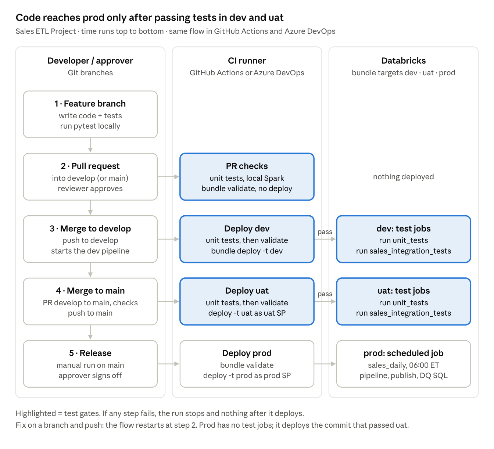
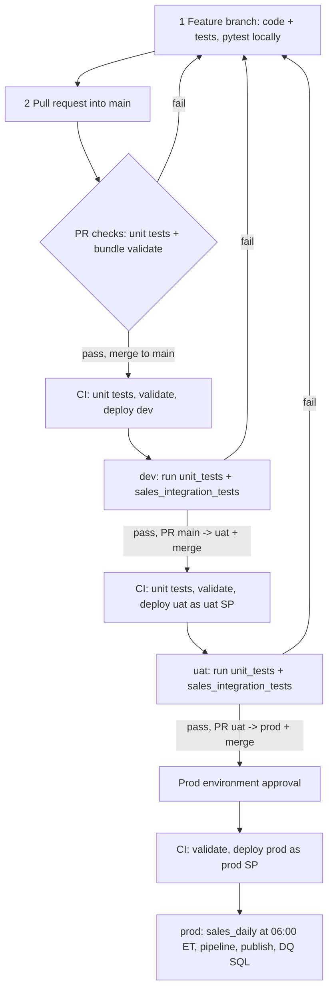
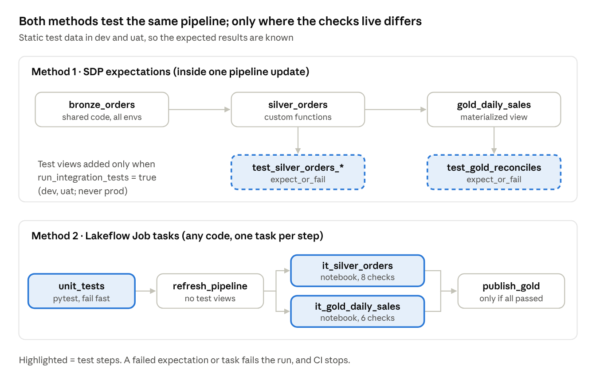

# Sales ETL Project

One repo with everything: the Declarative Automation Bundle (`sales_etl`), the pipeline and job
code, unit tests, integration tests, static test data, and CI/CD for **both** GitHub Actions and
Azure DevOps. Pick one CI system; both run the same steps at the same times.



## What runs when



| Trigger | GitHub Actions | Azure DevOps | Steps |
| --- | --- | --- | --- |
| PR into `main` | `ci_cd/github/deploy-dev.yml` | `ci_cd/azure_devops/deploy-dev.yml` (branch policy) | unit tests → `bundle validate` (no deploy) |
| Merge into `main` | `deploy-dev.yml` | `deploy-dev.yml` | unit tests → validate → deploy **dev** → `bundle run unit_tests` → `bundle run sales_integration_tests` |
| Merge into `uat` | `deploy-uat.yml` | `deploy-uat.yml` | unit tests → validate → deploy **uat** → `bundle run unit_tests` → `bundle run sales_integration_tests` |
| Merge into `prod` + approval | `deploy-prod.yml` | `deploy-prod.yml` | validate → deploy **prod** (no test jobs exist in prod) |
| Daily 06:00 ET (prod) | — | — | `sales_daily` job: pipeline → publish gold → DQ SQL check |

### The three test steps

| Step | Where | What | Kind |
| --- | --- | --- | --- |
| Before deploy | CI runner, local Spark | `pytest -m "not integration"` (tests 01–07, 09) | Unit tests |
| After deploy: `unit_tests` job | Databricks | pytest again on real compute + test 08 (Delta + MERGE in a temp schema) | Unit + one integration test |
| After deploy: `sales_integration_tests` job | Databricks | unit tests → seed `test_data/` → refresh pipeline (SDP expectation test views) → silver/gold check notebooks → publish gold | Integration tests on the whole pipeline |



## Layout

```
Sales ETL Project/
├── databricks.yml                     # bundle root: include + dev/uat/prod targets
├── pyproject.toml                     # pytest config (testpaths, pythonpath=src, markers)
├── requirements-dev.txt               # pyspark (pin to runtime), pytest, pytest-cov
├── ci_cd/                             # ALL CI/CD files, whichever tool you use (see ci_cd/README.md)
│   ├── azure_devops/                  # Azure DevOps:   deploy-dev | deploy-uat | deploy-prod
│   └── github/                        # GitHub Actions: deploy-dev | deploy-uat | deploy-prod (copy to .github/workflows/)
├── docs/
│   ├── setup-github.md                # one-time GitHub setup (OIDC, environments, branch rules)
│   ├── setup-azure-devops.md          # one-time ADO setup (service connections, environments, policies)
│   ├── ci-cd-flow.png
│   └── integration-test-methods.png
├── resources/
│   ├── variables/variables.yml        # ALL variables: declarations, then dev/uat/prod values + run_as/permissions
│   ├── jobs/sales_daily.job.yml       # the real job (all targets)
│   ├── pipelines/sales_pipeline.pipeline.yml
│   └── test_jobs/test_jobs.yml        # unit_tests + sales_integration_tests (dev + uat ONLY)
├── src/
│   ├── sales_etl/                     # custom functions: transforms, data_quality, integration_checks
│   ├── pipelines/sales/transformations/
│   │   ├── bronze_orders.sql          # shared pipeline code
│   │   ├── silver_gold.py             # shared pipeline code (uses sales_etl)
│   │   └── integration_tests.py       # SDP expectation test views (only when run_integration_tests = true)
│   ├── notebooks/
│   │   ├── publish_gold.py
│   │   ├── run_tests.py               # runs pytest on Databricks
│   │   ├── integration_tests/         # silver + gold check notebooks
│   │   └── setup/seed_test_data.py    # copies test_data/ into the dev/uat landing volume
│   └── sql/dq_checks.sql
├── test_data/                         # static orders + customers (dev/uat only); see test_data/README.md
├── tests/                             # pytest levels 01–09 + conftest.py
└── tests_sdp_editor/                  # SDP TestPipeline (Beta): Pipelines Editor only, not CI
```

## Get started

1. Pick your CI system and follow its guide: [GitHub](docs/setup-github.md) or [Azure DevOps](docs/setup-azure-devops.md).
   Azure DevOps runs the files straight from `ci_cd/azure_devops/`. GitHub only runs workflows from `.github/workflows/`
   at the repo root, so copy the three files from `ci_cd/github/` there.
2. Fill in placeholders: workspace hosts in `databricks.yml`; SP IDs, catalogs and volumes in the dev/uat/prod
   sections of `resources/variables/variables.yml`.
3. Run locally:

```bash
python -m venv .venv && source .venv/bin/activate     # Windows: .venv\Scripts\activate
pip install -r requirements-dev.txt                   # Java 17+ on PATH
pytest -m "not integration"                           # what CI runs before deploy
databricks bundle validate -t dev
databricks bundle deploy -t dev
databricks bundle run unit_tests -t dev
databricks bundle run sales_integration_tests -t dev
```

4. Branching: feature branch → PR into `main` (dev) → PR `main` → `uat` (uat) → PR `uat` → `prod` (prod).
