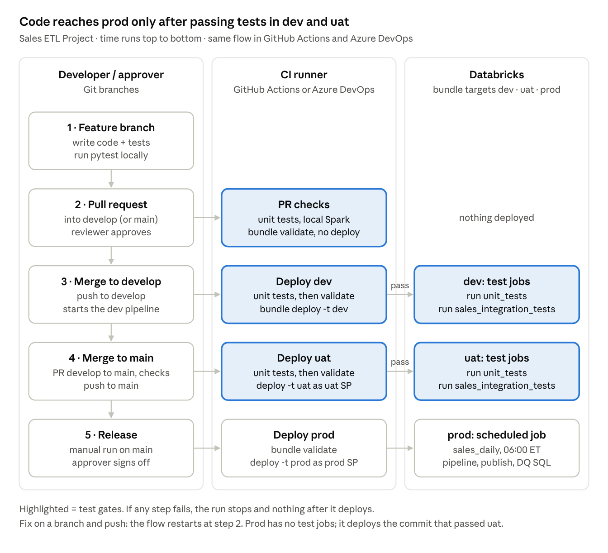

# Setup: Azure DevOps

One-time setup so `ci_cd/azure_devops/deploy-dev.yml`, `deploy-uat.yml` and `deploy-prod.yml`
run the right steps at the right time. No secrets are stored: each pipeline signs in through an
Azure Resource Manager service connection that uses **workload identity federation**.

## What each pipeline does

| Pipeline (YAML) | Trigger | Stages |
| --- | --- | --- |
| `deploy-dev.yml` | PR into `main` (branch policy) | `test` (unit tests + published results) → `validate` (no deploy) |
| `deploy-dev.yml` | Merge into `main` | `test` → `validate` → `deploy` (dev) + `bundle run unit_tests` + `bundle run sales_integration_tests` |
| `deploy-uat.yml` | Merge into `uat` | `test` → `deploy` (validate, deploy uat, both test jobs) |
| `deploy-prod.yml` | Merge into `prod` + environment approval | `deploy` (validate, deploy prod) |

## 1. Identities and Databricks access

For dev, uat and prod:

1. Create (or reuse) a Microsoft Entra service principal / managed identity per environment.
2. Add it to the matching Databricks workspace.
3. Grant Unity Catalog access:
   - dev/uat: `USE CATALOG`, `CREATE SCHEMA`, `USE SCHEMA`, `CREATE TABLE`, `CREATE MATERIALIZED VIEW`, `CREATE VOLUME`, `READ VOLUME`, `WRITE VOLUME` on `dev_sales` / `uat_sales`.
   - prod: only what the pipeline and job need on `prod_sales`.
4. Put the uat and prod SP application IDs in the uat and prod sections of `resources/variables/variables.yml`, and the workspace URLs in `databricks.yml`.

## 2. Service connections

Project settings → Service connections → New → **Azure Resource Manager** → **Workload identity federation**.
Create three, named exactly as the YAML expects:

| Name | Identity |
| --- | --- |
| `sc-databricks-dev` | dev SP |
| `sc-databricks-uat` | uat SP |
| `sc-databricks-prod` | prod SP |

Grant each pipeline permission to use only its own connection (Security → Pipeline permissions).

**AWS or GCP workspace?** Skip ARM. Use `DATABRICKS_AUTH_TYPE: azure-devops-oidc` with
`DATABRICKS_HOST`, `DATABRICKS_CLIENT_ID` and `SYSTEM_ACCESSTOKEN: $(System.AccessToken)` as
pipeline variables, and a Databricks federation policy with issuer
`https://vstoken.dev.azure.com/<org_id>`, audience `api://AzureADTokenExchange`, subject
`p://<org>/<project>/<pipeline>`.

## 3. Environments and approvals

Pipelines → Environments → create `databricks-dev`, `databricks-uat`, `databricks-prod`.

- `databricks-prod`: Approvals and checks → **Approvals** (your release approvers) and **Branch control** (`refs/heads/prod` only).
- Optional on `databricks-uat`: Branch control `refs/heads/uat`.

## 4. Create the three pipelines

Pipelines → New pipeline → your repo → **Existing Azure Pipelines YAML file**:

| Pipeline name | YAML path |
| --- | --- |
| `sales-etl-dev` | `/ci_cd/azure_devops/deploy-dev.yml` |
| `sales-etl-uat` | `/ci_cd/azure_devops/deploy-uat.yml` |
| `sales-etl-prod` | `/ci_cd/azure_devops/deploy-prod.yml` |

## 5. Branches and PR validation

1. Create `uat` and `prod` from `main`; feature branches come from `main`.
2. **Azure Repos ignore the `pr:` block in YAML.** Repos → Branches → `main` → Branch policies
   (also require PRs + reviewers on `uat` and `prod`):
   - Require a minimum number of reviewers (1+).
   - **Build validation** → pipeline `sales-etl-dev`, trigger Automatic, policy Required.
   (GitHub-hosted repos in Azure Pipelines use the YAML `pr:` block instead.)
3. The PR run executes `test` and `validate` only; the `deploy` stage is skipped for `PullRequest` builds.

## 6. First run

1. PR a feature branch into `main` (build validation runs), complete it: `sales-etl-dev` runs test → validate →
   deploy dev → test jobs. The first `sales_integration_tests` run seeds `test_data/` into
   `/Volumes/dev_sales/raw/landing` (catalog `dev_sales` must exist).
2. PR `main` → `uat`, complete it: `sales-etl-uat` deploys and tests uat.
3. PR `uat` → `prod`, complete it: `sales-etl-prod` waits for approval in the `databricks-prod` environment, then deploys.

Test results appear on each run's **Tests** tab (JUnit) and **Code Coverage** tab.

## Troubleshooting

| Symptom | Likely cause |
| --- | --- |
| "Could not find service connection" | Name differs from `SERVICE_CONNECTION` in the YAML, or pipeline not authorized to use it |
| PR shows no checks | Build validation policy missing (Azure Repos ignore YAML `pr:`) |
| Prod stage skipped | Not run from `prod` (stage condition) |
| `bundle deploy` uat/prod fails on branch | Checked-out branch doesn't match `git.branch` (`uat` / `prod`) in `databricks.yml` |
| Integration row-count check fails | `test_data/` changed without updating `expected_order_count` |
| Permission denied creating schema/volume | dev/uat SP is missing the UC grants in step 1.3 |
