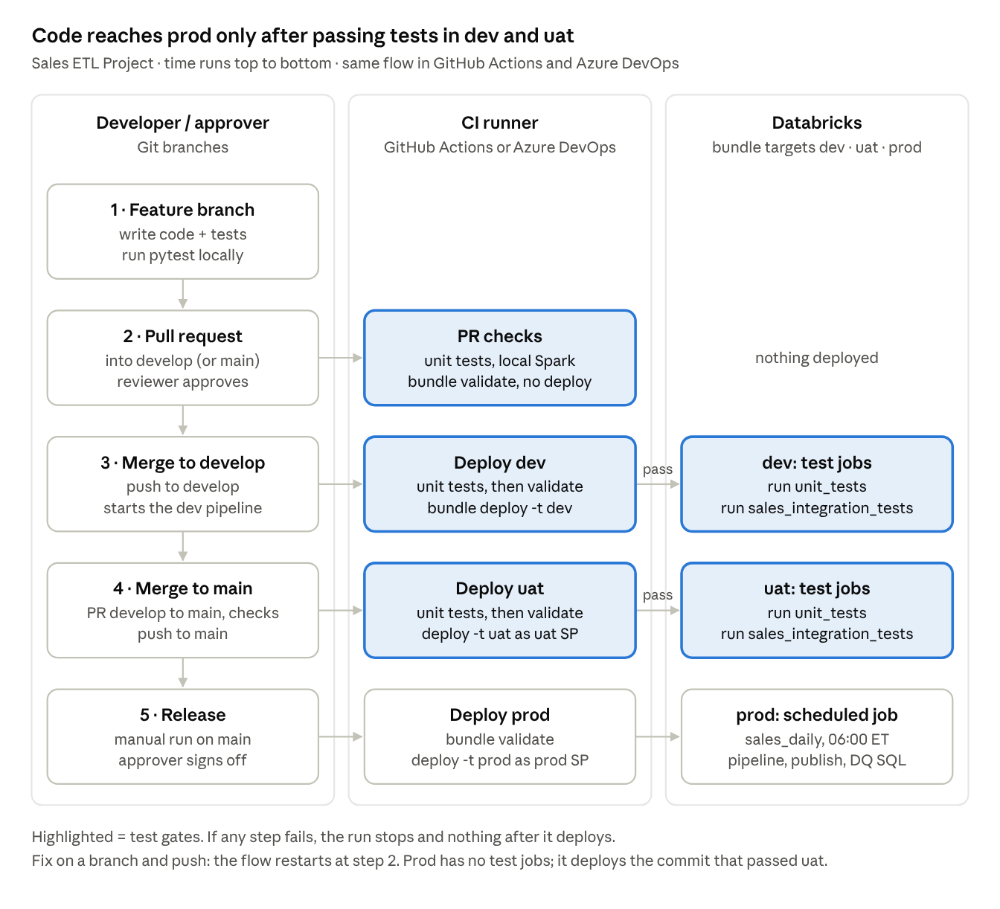

# Setup: GitHub Actions

One-time setup so the workflows in `ci_cd/github/` (`deploy-dev.yml`, `deploy-uat.yml`, `deploy-prod.yml`,
copied to `.github/workflows/` at the repo root)
run the right steps at the right time. No secrets are stored: GitHub signs in to Databricks
with OIDC (workload identity federation) as one service principal per environment.

## What each workflow does

| Workflow | Trigger | Steps |
| --- | --- | --- |
| `deploy-dev.yml` | PR into `main` | `unit-tests` job → `bundle validate` (no deploy) |
| `deploy-dev.yml` | Merge into `main` | `unit-tests` → validate → `bundle deploy` (dev) → `bundle run unit_tests` → `bundle run sales_integration_tests` |
| `deploy-uat.yml` | Merge into `uat` | `unit-tests` → validate → `bundle deploy` (uat) → `bundle run unit_tests` → `bundle run sales_integration_tests` |
| `deploy-prod.yml` | Merge into `prod` + reviewer approval | validate → `bundle deploy` (prod) |

## 1. Databricks: one service principal per environment

For dev, uat and prod (in each target workspace):

1. Create a service principal in the Databricks account (or Entra ID on Azure) and add it to the workspace.
2. Grant Unity Catalog access to its catalog:
   - dev/uat SPs: `USE CATALOG`, `CREATE SCHEMA`, `USE SCHEMA`, `CREATE TABLE`, `CREATE MATERIALIZED VIEW`, `CREATE VOLUME`, `READ VOLUME`, `WRITE VOLUME` on `dev_sales` / `uat_sales` (test schemas, test views and the seeded landing volume are created at run time).
   - prod SP: the grants the pipeline and job need on `prod_sales` only.
3. Add a **federation policy** to each SP:
   - Issuer: `https://token.actions.githubusercontent.com`
   - Audience: your Databricks account ID
   - Subject: `repo:<org>/<repo>:environment:<env>` (for example `repo:rearc/sales-etl:environment:dev`)
4. Put the uat and prod SP application IDs in the uat and prod sections of `resources/variables/variables.yml` (`run_as`, `permissions`).
5. Put the three workspace URLs in `databricks.yml` (`targets.<env>.workspace.host`).

## 2. GitHub: environments and variables

Repo → Settings → Environments → create `dev`, `uat`, `prod`. In each, add **variables** (not secrets):

| Variable | Value |
| --- | --- |
| `DATABRICKS_HOST` | That environment's workspace URL |
| `DATABRICKS_CLIENT_ID` | That environment's SP application (client) ID |

On `prod`: add **Required reviewers** and a **Deployment branches** rule allowing `prod` only.
Optional on `uat`: deployment branch rule `uat`.

## 3. Branches and protection

1. Create `uat` and `prod` from `main`. Work on feature branches from `main`.
2. Settings → Branches (or Rulesets) for `main`, `uat` and `prod`:
   - Require a pull request before merging (1+ approval).
   - On `main`, require status checks to pass: **`unit-tests`** and **`deploy`** from "Test and deploy bundle - dev"
     (they appear after the workflow has run once on a PR).
   - Require branches to be up to date before merging.

## 4. First run

1. Copy the three files from `ci_cd/github/` into `.github/workflows/` at the repo root and push.
2. Open a PR into `main`: the `unit-tests` and `deploy` (validate only) checks run.
3. Merge it: dev deploys, then the test jobs run. `sales_integration_tests` seeds `test_data/` into
   `/Volumes/dev_sales/raw/landing` on its first run (the catalog `dev_sales` must already exist).
4. PR `main` → `uat`, merge: uat deploys and is tested the same way.
5. PR `uat` → `prod`, merge: "Deploy bundle - prod" waits for reviewer approval, then deploys.

## Troubleshooting

| Symptom | Likely cause |
| --- | --- |
| `unit-tests` fails on import | Run `pytest -m "not integration"` locally; check `requirements-dev.txt` pins |
| OIDC login fails | Federation policy subject doesn't match `repo:<org>/<repo>:environment:<env>` exactly |
| `bundle deploy` (uat/prod) fails on branch | Checked-out branch doesn't match `git.branch` (`uat` / `prod`) in `databricks.yml` |
| `sales_integration_tests` row-count check fails | `test_data/` changed without updating `expected_order_count` |
| Permission denied creating schema/volume | dev/uat SP is missing the UC grants in step 1.2 |
| Workflows don't run | Copies from `ci_cd/github/` must be in `.github/workflows/` at the repo root |
